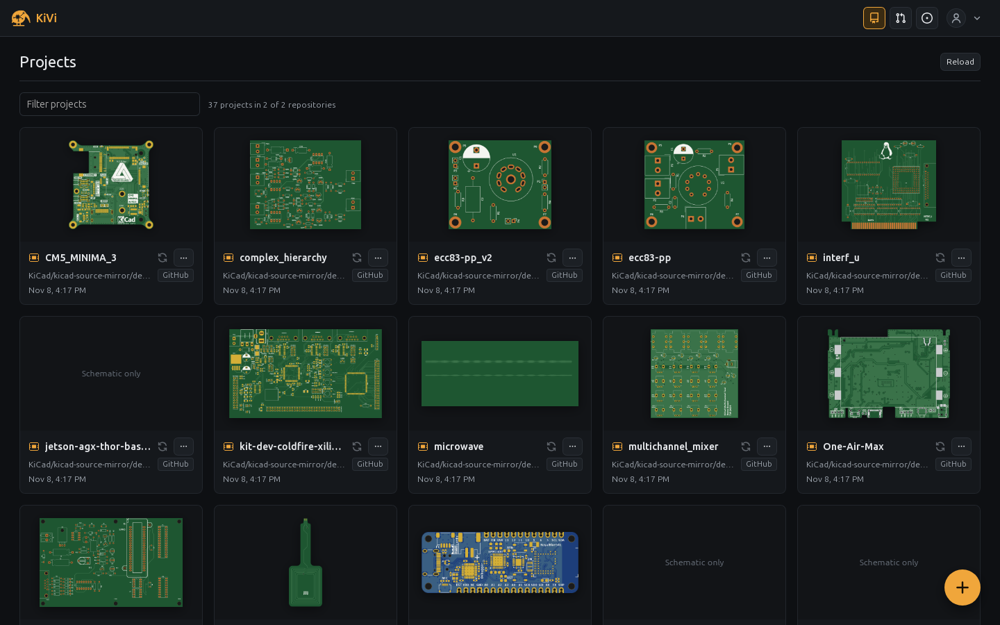
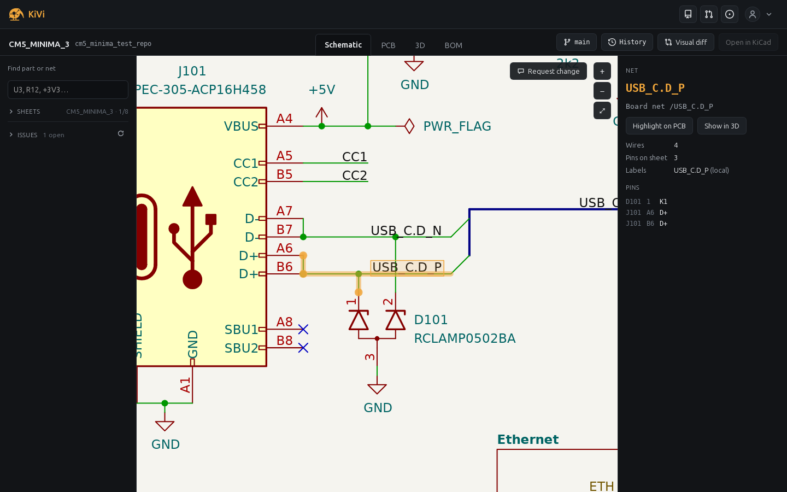
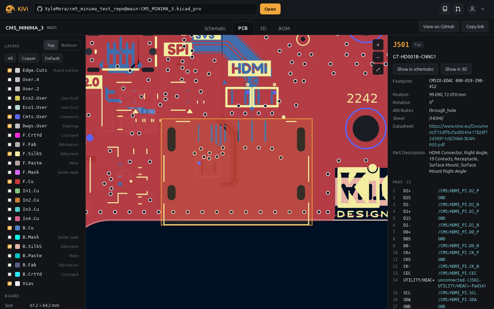
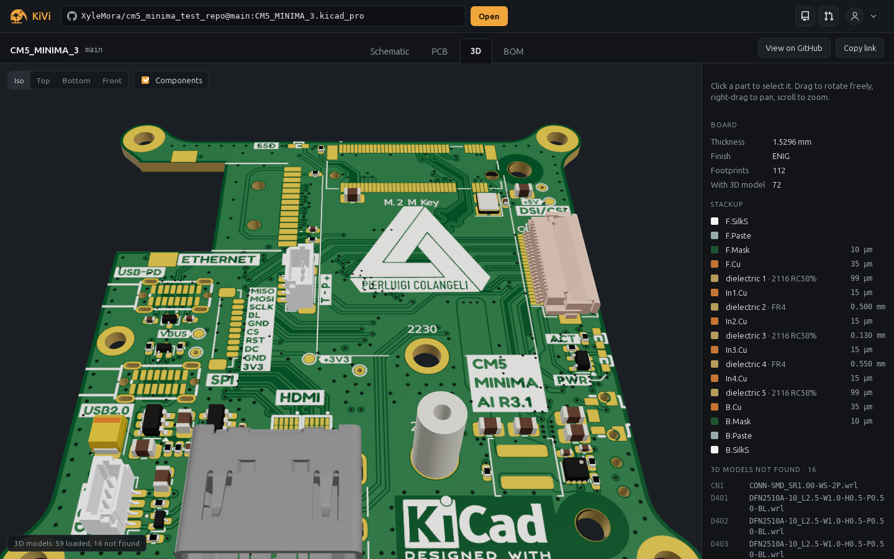
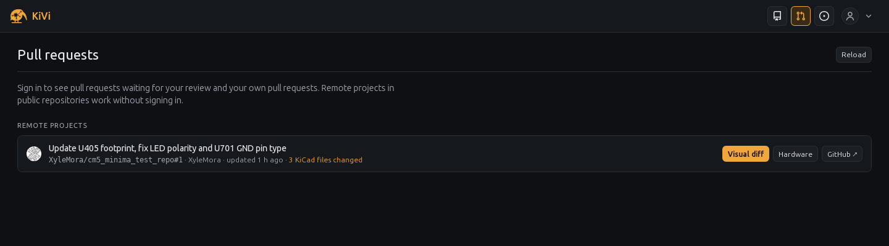
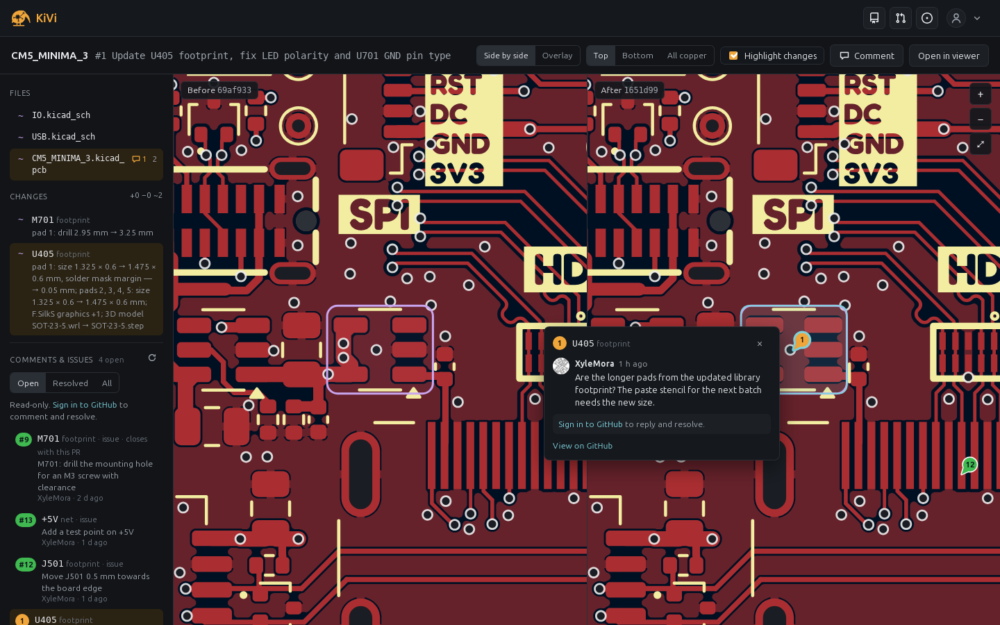

# KiVi — KiCad viewer and hardware review for GitHub

A desktop app ([Tauri 2](https://tauri.app)) for browsing, viewing and
reviewing KiCad projects. GitHub stays the place for source control, diffs and
review comments; KiVi renders what's in it. Everything is parsed and rendered
on your computer.



## A quick tour

**Projects.** The home screen finds every `.kicad_pro` in the
repositories you can reach and shows each as a card. The
filter narrows the grid by project, repository or folder name as you type;
a card's `⋯` menu opens the schematic, PCB, 3D view, BOM or GitHub directly.


**Schematic.** Click a symbol to inspect it: its fields, datasheet and every
pin with its net. **Show on PCB** and **Show in 3D** jump to the same part (cross-probe).




**PCB.** Layers can be switched one by one (or *Copper*, *Default*, *All*),
the board flipped to the bottom, and footprints, pads and tracks inspected.




**3D.** The board in 3D with the stackup from the KiCad file (soldermask,
finish and silkscreen colours, layer thicknesses) and component models from
KiCad's library, the project and any extra model sources. Models come from
the web by default; with KiCad installed, add its model folder in Settings
(**Add folder…**, e.g. `/usr/share/kicad/3dmodels` or
`C:\Program Files\KiCad\9.0\share\kicad\3dmodels`) to load them from disk:
faster, offline, and matching your KiCad version. Each model is looked for in
the project first, then in model folders, then in web sources (URLs and GitHub
repositories), the first found wins.




**Pull requests.** The second icon in the header lists open pull requests in
watched repositories and, once you sign in, those waiting for your review and
your own. Each says how many KiCad files it changes; **Visual diff** and
**Hardware** open it in KiVi.




**Visual diff.** A pull request, commit or branch comparison, side by side or
overlaid, with a list of what changed in KiCad terms rather than text. During pull request review users can leave comments pinned where they belong (to actual components or traces):




## Building (Linux)

```sh
# once: system libraries and Rust
sudo apt install libwebkit2gtk-4.1-dev libxdo-dev libayatana-appindicator3-dev librsvg2-dev build-essential
curl --proto '=https' --tlsv1.2 -sSf https://sh.rustup.rs | sh
cargo install tauri-cli --version "^2" --locked

cargo tauri dev        # run from source
cargo tauri build      # release binary + AppImage in src-tauri/target/release/bundle/appimage/
```

Windows builds the same way, with Rust and Python installed:
`cargo tauri build --no-bundle` makes `src-tauri/target/release/kivi-desktop.exe`,
which runs as it is, with the pages built in (plain `cargo tauri build` also
makes an NSIS installer, set in `src-tauri/tauri.windows.conf.json`, which Tauri
merges on Windows). macOS would too, but isn't set up or tested. Tauri doesn't
cross-compile. The pages are plain ES modules with no build
step; `tools/build_web.py` (run by Tauri) copies them to `dist/web`.

## GitHub sign-in

Sign-in uses a GitHub App (free, no server). Unlike an OAuth App, it asks for
fine-grained permissions instead of the `repo` scope (full access to every
private repository), and users choose which repositories it can read.


Signing in from the account menu shows a one-time code (like `WDJB-MJHT`) and
a **Copy code and open GitHub** button; you paste the code on
github.com/login/device and approve KiVi, and the dialog finishes by itself. If
the App isn't installed on any of your accounts yet, it then offers **Install on
GitHub** to choose the repositories.

How it behaves:

- The device-flow endpoints don't send CORS headers, so those requests run in
  Rust (`src-tauri/src/lib.rs`).
- The token only reaches repositories where the App is **installed** (and the
  user has access); public repositories are readable regardless. After signing
  in, if the App isn't installed anywhere yet, the dialog links to its install
  page; the account menu has **Repository access** for changing it later.
  "Waiting for your review" only lists PRs in repositories the App can see.
- User tokens expire after 8 hours. The refresh token (valid 6 months, single
  use) is stored next to the token and the app swaps it for a new pair before
  expiry: when a page opens, on a timer, and when the window regains focus.
  Device-flow tokens refresh without the client secret, so none is shipped.
- An organisation that restricts third-party access may need an owner to
  approve the installation.
- Permissions the App needs (repository permissions): *Metadata: Read-only*,
  *Pull requests: Read and write* (review comments) and *Contents: Read and
  write* (reading files, and pushing from a local copy). After raising a
  permission in the App's settings, each installation has to accept it once.

## Project gallery

- Repositories come from `GET /user/installations` and
  `/user/installations/{id}/repositories`, plus the watched repositories.
- Each repository's default branch is listed with one recursive tree request;
  each `.kicad_pro` is a project (without one, only a loose `.kicad_pcb` counts).
  The result is cached per repository and reused until the repository's last
  push or default branch changes, so **Refresh** with no new commits only costs
  the repository listing.
- Thumbnails are the realistic front face (soldermask, copper, silkscreen),
  clipped to the board outline. They're rendered when a card scrolls into
  view, two at a time, and cached by the board file's git blob SHA, so each
  board version is downloaded and rendered once. Boards over 30 MB aren't
  previewed.
- The grid renders 48 cards at a time and adds more as you scroll.
- The scan stops at a rate-limit error and keeps what it found.

## Local copies, branches and pushing

A project from the gallery can be worked on in a folder on your computer and
pushed back, without Git installed: KiVi has git built in (libgit2, through the
Rust `git2` crate), with HTTPS going through the same TLS stack as sign-in.

- **Download** (a project card's `⋯` menu) clones the whole
  repository into `<chosen folder>/<repository>` and opens the project from it.
  **Link** instead uses a clone you already have; KiVi checks
  that it is a clone of that repository and never changes its files or history.
  Once linked, the card (its name, thumbnail and views) always opens the local
  copy; **Unlink** goes back to opening it from GitHub.
- Each card has a sync icon left of its `⋯` menu (hover it for the details):
  grey when the project isn't on this computer, green when the local copy has
  nothing uncommitted and its branch is at the same commit as on GitHub, yellow
  when it differs (uncommitted changes, commits to push, newer commits on
  GitHub). It asks GitHub for its branch tips (one small request per linked
  repository, no download), again on **Refresh** and when the window regains
  focus; offline it compares with what the copy last fetched.
- The project bar looks the same for a GitHub project and a local copy: the
  project and its repository or folder on the left, the branch button
  (`⎇ main`) on the right. Its menu lists the branches (with a filter); picking
  one switches to it. For a GitHub project that reopens the project on that
  branch; for a local copy it checks the branch out (GitHub branches the copy
  doesn't have yet included, marked "on GitHub"): uncommitted edits come
  along, unless that branch changes the same files, then nothing happens and
  KiVi says why.
- With a local copy open, the branch button also counts the changed files and
  its menu has:
  - **New branch…** creates a branch at the current commit and switches to it;
    uncommitted edits come along.
  - **Visual diff of changes** compares the working files, uncommitted edits
    included, with the point where the branch left main (after updating main
    from GitHub), like the pull request would: `diff.html#local=<folder>`.
  - **Commit and push…** lists the changed files with checkboxes, commits the
    chosen ones with your message and pushes the branch to the same branch on
    GitHub, then offers to open a pull request. The commit author is your git
    identity if the clone has one, else your GitHub account with its private
    e-mail address. On `main` it warns first, since protected branches refuse it.
- GitHub is always reached at `https://github.com/<owner>/<repo>.git` with your
  sign-in token (in a request header, never stored in the clone), so a clone
  with an SSH remote works too. There's no pull or merge: if GitHub has commits
  on your branch that the copy doesn't, the push is refused; push to a new
  branch, or update the clone with git.

## Links into the viewer

```
index.html#gh=owner/repo@main:hardware&tab=pcb&sel=U3     project in a repository
index.html#gh=owner/repo&pr=owner/repo%2312               … at a pull request's head, with its review comments
index.html#folder=/path/to/project                        local folder
diff.html#gh=owner/repo&pr=42                             visual diff of a pull request
diff.html#gh=owner/repo&commit=<sha>                      … of a commit
diff.html#gh=owner/repo&base=main&head=feature&file=hw/board.kicad_pcb
inbox.html#projects, inbox.html#prs                       home screen views
```

The repository box in the header takes `owner/repo`,
`owner/repo@branch:path/to/project` or any
`https://github.com/owner/repo/tree/<ref>/<path>` URL.

## Review comments on pull requests

In the visual diff of a pull request, and in the viewer opened at a pull
request (marked *PR #N* in the project bar), press **C** (or **Comment**) and
click a footprint, pad, trace/net, symbol, wire or an empty spot to comment on
it. Comments are pinned on the canvas and listed in the side panel (Open /
Resolved / All); click a pin to read the thread, reply or resolve it. The same
threads show up in both places, numbered the same way; in the schematic the
list covers every sheet and jumps to the one a comment is on.

They are ordinary GitHub review comments on the `.kicad_sch` / `.kicad_pcb`
file, so they appear in the pull request conversation and *Files changed*,
notify reviewers, and share GitHub's resolve state both ways. What a comment
points at is kept in a hidden `<!-- kivi:{…} -->` marker (stable UUID /
reference / pad / net name plus the clicked point), so pins follow parts and
nets across later pushes; when the element is gone the pin stays where it was,
marked as not found. A comment on the HDMI connector is stored on GitHub as:

```markdown
Can the HDMI connector move 1 mm towards the edge? The shield tabs touch the keep-out.

<sub>📍 KiVi · footprint **J501**</sub>
<!-- kivi:{"v":1,"type":"footprint","ref":"J501","x":99.09,"y":72.07,"side":"head"} -->
```

On github.com it reads as the text with a small "📍 KiVi · footprint **J501**"
line under it; in KiVi it's a pin on J501.

Reading comments on public repositories works without signing in (resolve
state needs it). Posting, replying and resolving need the GitHub App's *Pull
requests: Read and write* permission.

## Layout

```
index.html              viewer
diff.html               visual diff
inbox.html              home screen (projects, pull requests)
src/sexpr.js            S-expression parser (+ tree helpers)
src/geom.js             matrices, arcs, bounding boxes
src/text.js             text layout (KiCad metrics, markup, escapes)
src/drawing-sheet.js    .kicad_wks parser/renderer, built-in default sheet
src/project.js          project discovery, hierarchy walk, page numbering
src/sources.js          GitHub (API, PR/commit comparison), 3D model path resolution
src/diff/               semantic schematic and board diffs, comment anchors
src/review.js           review comments on GitHub (threads, replies, resolve)
src/sch/                schematic model, renderer, themes
src/pcb/                board model, renderer, shapes, hit testing,
                        outline extraction, face textures, three.js scene,
                        STEP conversion (worker) and its cache
src/app/                UI: tabs, pan/zoom viewport, inspectors, BOM, diff page
src/desktop/
  tauri.js              TauriSource (folder on disk), drag and drop, link routing,
                        sign-in, token refresh
  desktop.js            additions to the viewer and diff pages
  account.js            header on every page: home icons, account menu, Settings dialog
  inbox.js, desktop.css home screen: view switch, pull requests
  projects.js           project gallery: repository scan, caches, cards
  thumb-worker.js       board thumbnails (parse + render off the main thread)
  git.js                local copies: download/link, branch menu, commit and push
  icons.js              header and menu icons (repository / pull request follow Octicons)
src-tauri/              Rust app
  src/lib.rs            commands: open_folder, list_folder, read_file, startup_folder,
                        model folders, github_client_id, github_app_slug,
                        github_device_start/poll/refresh
  src/git.rs            git commands (clone, branch, local changes, commit, push)
  src/git_http.rs       git over HTTPS through reqwest (no OpenSSL)
  tauri.conf.json       window, CSP, bundle targets
  capabilities/         which plugin APIs the page may call
  icons/                app icons (tools/make_icons.py)
vendor/                 three.js 0.169, occt-import-js (LGPL-2.1), see vendor/README.md
tests/                  headless checks (gjs), Tauri API mock
tools/                  build, CLI rendering, visual comparison, icons, headless browser
assets/                 logo (SVG)
docs/screenshots/       README images
```

The parsers and SVG renderers have no DOM dependency, so they run in a page, a
worker, or headless.

## Logo and icons

`assets/kivi-logo.svg` is the logo. The page headers show it in the header's
colours (`src/app/logo.js` inlines it: the orange parts follow the brand colour, the
white ones the header background). The app icons in `src-tauri/icons/` are
generated from it:

```sh
python3 tools/make_icons.py
```

## Tests and visual checks

The tooling runs on `gjs` (GNOME's JavaScript runtime), so Node is not needed.
The tests use KiCad's demo projects without a KiCad installation:
`tests/kicad-demos.txt` lists the design files they read (170 files, 74 MB, at a
pinned KiCad release, with git hashes), and `tools/fetch_demos.py` downloads
those from KiCad's GitHub mirror into the git-ignored `tests/kicad-demos/`,
checking each hash and skipping files already there.

```sh
python3 tools/fetch_demos.py                     # get / verify the listed files
python3 tools/fetch_demos.py --refresh 10.0.7    # move the list to another KiCad release

# Parse and render every KiCad demo project, check invariants
# (envelope, NaN, unresolved references, pin-to-wire connectivity, footprints)
gjs -m tests/run.js               # or: gjs -m tests/run.js path/to/projects …
gjs -m tests/diff.js
gjs -m tests/nets.js
gjs -m tests/review.js
gjs -m tests/models.js
cargo test --manifest-path src-tauri/Cargo.toml --lib   # Rust side: model folders, git (needs dist/web: run tools/build_web.py once)

# Render a file to SVG
gjs -m tools/render.js board.kicad_pcb out.svg --layers F.Cu,F.SilkS,Edge.Cuts
gjs -m tools/render.js board.kicad_pcb face.svg --face front     # 3D texture artwork

# Optional, manual, needs KiCad installed: compare against KiCad's own export
kicad-cli sch export svg -o ref/ project.kicad_sch
python3 tools/compare.py ref/project.svg out.svg cmp.png  x0 y0 x1 y1  [px_per_mm]

# Smoke test: every page loads without script errors, the viewer opens
# pic_programmer (headless WebKit, Tauri API mocked, no network)
tests/smoke.sh

# Drive the pages yourself (served over HTTP, Tauri API mocked)
python3 -m http.server 8000 &
LIBGL_ALWAYS_SOFTWARE=1 xvfb-run -a gjs -m tools/browser-check.js \
  "http://127.0.0.1:8000/inbox.html#projects" shot.png \
  --prelude "$(cat tests/tauri-mock.js)" --wait "document.querySelector('.project-card')"
```

What a passing run prints:

```console
$ python3 tools/fetch_demos.py          # here 5 files were missing or damaged
downloading 5 of 170 KiCad 10.0.6 demo files from KiCad/kicad-source-mirror …
  1.3 MB in 3 s
tests/kicad-demos: 170 KiCad 10.0.6 demo files ready
$ gjs -m tests/diff.js | tail -1
all diff checks passed
$ tests/smoke.sh
ok    home
ok    pull-requests
ok    viewer
ok    diff
```

## Continuous integration

`.github/workflows/ci.yml` runs the tests on every pull request and push to
`main` (or `master`), and builds only for releases and manual runs:

1. **Tests**: installs gjs, WebKitGTK and xvfb, restores the KiCad demo files
   from the Actions cache (keyed on `tests/kicad-demos.txt`, so they're
   downloaded only when the list changes or the cache expired after 7 unused
   days), then runs the unit tests, the full demo sweep and `tests/smoke.sh`.
2. **Rust tests**, alongside: `cargo test` on the Rust side
   (`src-tauri/src/lib.rs`), with the Rust build cached, and a check that
   `THIRD-PARTY-NOTICES.md` is up to date. Both builds below wait for both test
   jobs.
3. **Build (Linux)**, only for tags and manual runs (*Run workflow* on the
   Actions tab): `cargo tauri build`, with the Rust build and the Tauri CLI
   cached; lists the AppImage's bundled system libraries in
   `appimage-libraries.md`. The AppImage and that list are the `kivi-linux`
   artifact.

4. **Build (Windows)**, likewise: `cargo tauri build --no-bundle` on a Windows runner; the
   `kivi-windows` artifact holds `KiVi_<version>_x64.exe` with `LICENSE` and
   `THIRD-PARTY-NOTICES.md` next to it (GitHub zips every run artifact for
   download; release files aren't).

Pushing a tag `v<version>` (matching `version` in `src-tauri/tauri.conf.json`,
checked) runs all four and publishes a GitHub Release with the AppImage, the
Windows `.exe`, `LICENSE`, `THIRD-PARTY-NOTICES.md` and `appimage-libraries.md`.
Merges don't build, so run the workflow by hand on `main` before tagging and
check both builds pass.

Neither needs installing: on Linux make the AppImage executable and run it; on
Windows download the `.exe` and run it. It needs the WebView2 runtime, which
is part of Windows 11 and comes with Edge updates on Windows 10 (otherwise get
the *Evergreen* runtime from Microsoft). The `.exe` isn't code-signed, so
Windows SmartScreen warns on first run (*More info* → *Run anyway*). Settings
and sign-in are kept per user (`%LOCALAPPDATA%\app.kivi.desktop` on Windows,
`~/.local/share/app.kivi.desktop` on Linux), not next to the program.

Set the repository variables `KIVI_GITHUB_CLIENT_ID` and `KIVI_GITHUB_APP_SLUG`
(Settings → Secrets and variables → Actions → Variables) to build the GitHub
App in; without them the sign-in dialog asks for it.

## Known limitations

- Text uses a regular sans font scaled to KiCad's metrics instead of KiCad's
  stroke font (the newstroke font data is GPL-2.0, so it is not bundled).
  Layout and anchoring match, but glyph shapes differ.
- The default 3D model library is the KiCad 6-era GitHub mirror of
  `kicad-packages3D`; models added in later KiCad versions are not shown unless
  you add your KiCad installation's model folder or another mirror to the model
  sources in Settings. A folder source can only be read by the desktop app,
  which hands out nothing but `.wrl`/`.step`/`.stp` files inside that folder. A GitHub repository
  source is listed once through the API, so it counts against the rate limit.
  STEP models load through the bundled `occt-import-js` (7.7 MB of
  WebAssembly, loaded on first use), in a background worker so the window
  stays responsive. Converting a STEP model takes 0.3–1 s, so the result is
  cached on disk: the first view of a board with many STEP models (KiCad 10's
  library is STEP only) takes as long as before, reopening it is several times
  faster (24 s → 5 s on CM5_MINIMA_3).
- Git LFS files are not fetched.
- Schematic nets are traced per sheet (wires, junctions, labels, pins) and
  mapped to board nets through component pins; the name shown is the board's
  when there is one. Buses are not traced.

## Not done yet

- The token and refresh token are kept in the webview's localStorage; a release
  should keep them in the OS keychain (e.g. the `keyring` crate), at least the
  long-lived refresh token.
- Pulling or merging into a local copy (KiVi clones, branches, commits and
  pushes, but doesn't bring later GitHub commits into an existing copy).
- Auto-update, code signing, notarisation (macOS), file associations in the
  bundle config.

## Licence

KiVi is free software: you can redistribute it and/or modify it under the terms
of the [GNU General Public License](LICENSE), version 3 or (at your option) any
later version. It comes with no warranty.

It includes third-party software under its own licences: three.js (MIT),
Chevrotain (Apache-2.0), occt-import-js with Open CASCADE Technology (LGPL-2.1)
and the Rust crates behind Tauri (mostly MIT and Apache-2.0).
[THIRD-PARTY-NOTICES.md](THIRD-PARTY-NOTICES.md) has their licence texts and is
installed with the app. Regenerate it with `python3 tools/notices.py` after
changing `Cargo.lock` or `vendor/` (CI fails if it's out of date). The AppImage
also bundles system libraries (GTK, WebKitGTK, GStreamer…) from the build
machine; each release lists them with their licences and sources in
`appimage-libraries.md`.
